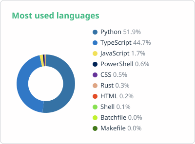

<!-- studio:settings user=Xakuraii theme=radical hl=2 border=show follow=on light=vue -->

<!-- studio:header -->
<h1 align="center">Welcome to Xakuraii!</h1>

Xaku Projects uses AI to turn ideas into useful open-source applications that simplify life and boost productivity.

  <picture>
    <source media="(prefers-color-scheme: dark)" srcset="https://raw.githubusercontent.com/Xakuraii/Xakuraii/main/profile-assets/typing-dark.svg?lines=XakuProjects;Open%20Source&font=VT323&size=22&width=470&center=true" />
    
  </picture>

<!-- studio:langs -->

  <picture>
    <source media="(prefers-color-scheme: dark)" srcset="https://raw.githubusercontent.com/Xakuraii/Xakuraii/main/profile-assets/card-langs-dark.svg?layout=donut&langs_count=20" />
    
  </picture>

